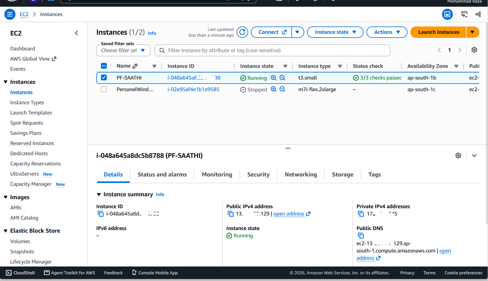

# My PF Saathi

My PF Saathi is a Telegram bot project designed to help users navigate common EPFO-related tasks.

## Live Telegram Bot

[Open My PF Saathi on Telegram](https://t.me/PFSAATHIBOT)

## Project Screenshots

### 1. Bot Welcome Screen


### 2. Feature Working


### 3. AWS EC2 Deployment



## Demo Video

[Watch the My PF Saathi Demo](https://www.youtube.com/shorts/R9oq0My973c)

## Features

- PF passbook balance checking
- Guided EPFO password recovery workflow
- Hindi and English interaction
- Configurable concurrent job processing
- Admin-only usage statistics

## Tech Stack

- Node.js and JavaScript
- Telegraf
- Playwright
- PostgreSQL

## Setup

1. Install Node.js and PostgreSQL.
2. Clone this repository.
3. Install project dependencies:

   ```bash
   npm install
   ```

4. Install the Playwright Chromium browser:

   ```bash
   npx playwright install chromium
   ```

5. Create a PostgreSQL database and apply the SQL schema from `src/db/schema.sql`.
6. Create a local `.env` file with your own configuration.
7. Start the bot:

   ```bash
   node src/bot.js
   ```

## Environment Configuration

Configure these variables in your local `.env` file:

- `BOT_TOKEN`
- `ADMIN_TELEGRAM_ID`
- `DB_HOST`
- `DB_PORT`
- `DB_NAME`
- `DB_USER`
- `DB_PASSWORD`
- `MAX_CONCURRENT_JOBS`

Replace placeholders with your own values. Never upload `.env` or share credentials publicly.

## Disclaimer

This is an independent project and is not affiliated with or endorsed by EPFO. Use official EPFO services for account-related operations.
